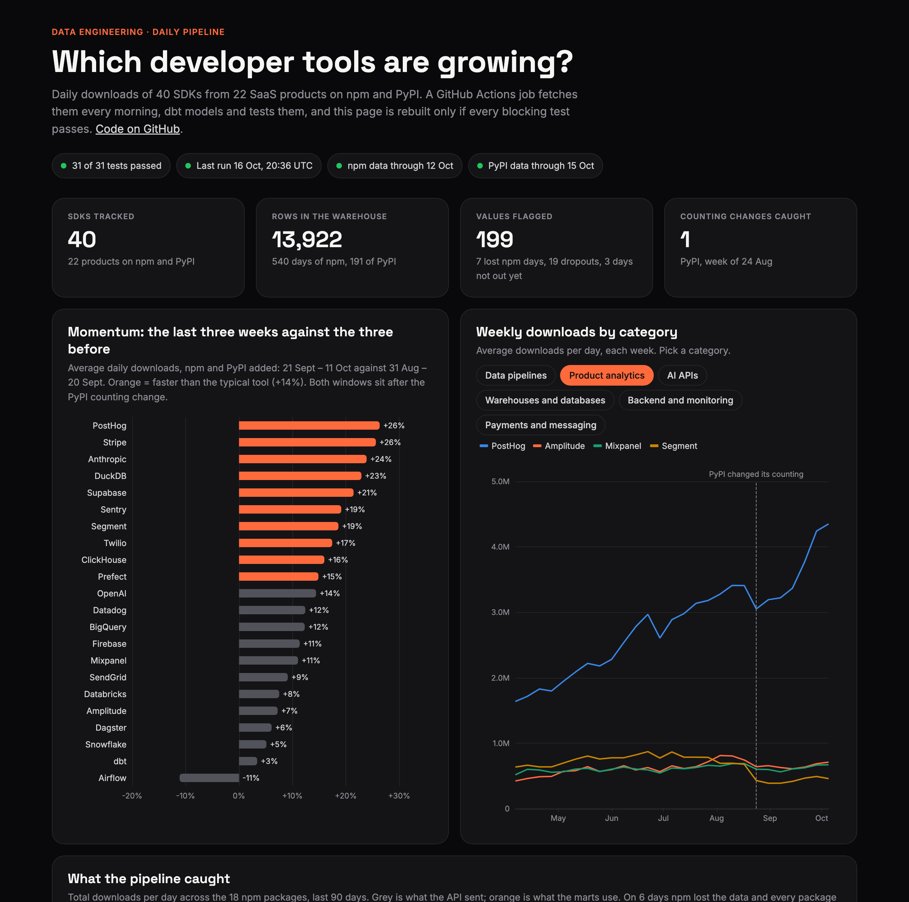

# Which developer tools are growing? A daily data pipeline

A pipeline that runs every morning on GitHub Actions: it fetches daily downloads of 40
SDKs from 22 SaaS products on npm and PyPI, models and tests them in dbt, and rebuilds a
live dashboard only if the tests pass.

**Live dashboard:** https://azadvoryanskiy.github.io/data-pipeline-sdk-downloads/

**Skill on show: data engineering.** Incremental, rate-limited extraction from two APIs,
an idempotent landing zone, dbt models from staging to marts, 31 data tests that block a
bad deploy, automatic detection of missing data and of a source changing how it counts,
and a scheduled job that runs the whole thing without me.

**The answer in one line:** the hard part isn't fetching the numbers, it's knowing when
not to believe them. npm lost 7 whole days in 18 months and PyPI changed how it counts in
August 2026; without the checks, dbt would look like it had lost 80% of its users.



## Business problem

A product or marketing team at a developer-tools company wants a daily read on which tools
developers are adopting: its own and its competitors'. Package downloads are a free,
public signal for that. But the APIs behind them are messy. They report zero when they
mean "no data", publish late, rate-limit, and change their counting without notice.

The job: a pipeline that runs every morning, unattended, and never puts a wrong number
on the dashboard.

## Data

| Source | What it gives | History | Delay |
|---|---|---|---|
| [npm downloads API](https://github.com/npm/registry/blob/main/docs/download-counts.md) | downloads per package per day | 18 months | about 3 days |
| [pypistats.org](https://pypistats.org) | downloads per package per day, mirrors excluded | about 180 days | 1 day |

40 packages ([`seeds/packages.csv`](seeds/packages.csv)), mapped to 22 products in six
categories: product analytics (Mixpanel, Amplitude, PostHog, Segment), warehouses and
databases, data pipelines, AI APIs, payments and messaging, backend and monitoring.

**One caveat.** Downloads count installs, including automated builds, so they show
momentum, not the number of customers.

## How it works

```
GitHub Actions, 07:00 UTC
  │
  ├─ 1. Extract   pipeline/extract.py      last 14 days from both APIs, pauses and retries on 429
  ├─ 2. Land      data/raw/{npm,pypi}/     one CSV per source per day, committed to the repo
  ├─ 3. Model     dbt on DuckDB            staging → flagged → marts
  ├─ 4. Test      31 dbt tests             any failure stops the job here
  └─ 5. Publish   pipeline/export.py       one JSON file → site/ → GitHub Pages
```

- **Safe to re-run.** Each run rewrites the last 14 days. A day npm hadn't published
  yesterday is filled in today, and running twice gives the same files.
- **All or nothing per source.** If one package keeps failing, nothing for that source is
  written, so a half-filled day never replaces a complete one.
- **Flag, don't delete.** [`int_downloads__flagged`](models/intermediate/int_downloads__flagged.sql)
  keeps every value the API sent and marks the ones that aren't real counts.
- **Counting changes.** [`int_source_breaks`](models/intermediate/int_source_breaks.sql)
  finds weeks when every package of a source drops at once and stays down. Growth is never
  measured across one.

The tests ([`models/**/_*.yml`](models/marts/_marts.yml), [`tests/`](tests/)): one row
per package per day, no missing days, no negative counts, no unknown packages, every
package landed, flagged values never counted, growth never crossing a counting change,
and a freshness warning if a source stalls.

## Insights

1. **Zero doesn't mean zero.** On 7 days in 18 months npm returned 0 for every package
   at once, most recently on 6 October 2026, and its last 3 days are always 0 because they
   aren't published yet. Single packages also dropped to 0 on 19 occasions, mostly on
   3–5 June 2026. All of these are flagged as missing, not counted as a crash.
2. **PyPI changed how it counts in the week of 24 August 2026.** All 22 PyPI packages fell
   in the same week, 21 of them by more than a fifth; the typical one dropped to 67% of the
   week before and was still at 66% three weeks later. A
   20-week comparison across that week would have shown dbt down 80% and Airflow down 66%.
3. **Recent momentum, measured only after the change:** the three weeks from 21 September
   against the three weeks before. PostHog +26%, Stripe +26%, Anthropic +24%, DuckDB +23%.
   The typical tool grew about 14%; Airflow is the only one that shrank, −11%.
4. **PostHog's SDKs are downloaded over 6 times as often as Mixpanel's or Amplitude's**:
   4.1 million a day against 0.65 and 0.68 million, and growing more than twice as fast.

## Recommendations

**For anyone using these numbers:** compare whole weeks, not days, because weekends run at
about half a weekday. And never compare across a counting change; the pipeline marks
them, and the dashboard says so.

**What I'd add next:**

- An alert (email or Slack) when a test fails or a new counting change is detected,
  instead of finding out from a stale dashboard.
- Keep every day's API answer instead of overwriting it, to see how often npm revises
  its numbers.
- If more people used it, move the warehouse from a DuckDB file built in CI to
  MotherDuck or BigQuery. The dbt models wouldn't change.

## Run it yourself

```bash
pip install -r requirements.txt
python pipeline/extract.py --backfill     # first time only: all the history both APIs keep
dbt build --profiles-dir .                # models and tests, under a second
python pipeline/export.py                 # writes site/data/dashboard.json
python -m http.server --directory site    # the dashboard at http://localhost:8000
```
